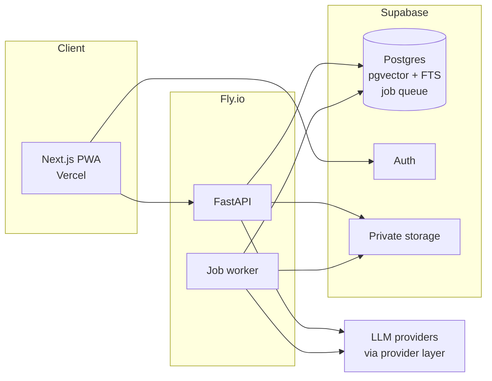

# Engram Roadmap

Engram is a study system that turns course materials into spaced-repetition practice. Users bring textbooks, lecture slides, notes and readings. Engram parses them, generates flashcards and practice questions that cite the exact page they came from, schedules reviews with FSRS, and answers questions about the material when the user gets stuck.

It replaces ScholarRAG, a single-afternoon "chat with your textbook" prototype. None of the prototype code is kept.

## Contents

- [Goals](#goals)
- [Users](#users)
- [Product](#product)
- [Architecture](#architecture)
- [Ingestion pipeline](#ingestion-pipeline)
- [Learning model](#learning-model)
- [Evaluation](#evaluation)
- [UX principles](#ux-principles)
- [Privacy and data](#privacy-and-data)
- [Phases](#phases)
- [Decision log](#decision-log)

## Goals

1. **Be a study tool people actually use.** Active recall with spaced repetition beats rereading and chatting, so the product is built around that, and chat is a fallback for when a user is confused.
2. **Be trustworthy.** Every generated card and every answer links back to the passage it came from. A card that teaches something wrong is worse than no card.
3. **Showcase engineering depth** in document intelligence, learning-science algorithms, evaluation of generated content, and measured real-world usage.

When the second and third goals conflict with the first, usefulness to users wins.

## Users

| Role | Who | What they do |
|---|---|---|
| **Student** | Non-technical university students. The initial focus is subjects heavy in terminology, diagrams and argument (life sciences, social sciences), with CS and STEM supported too. | Reviews cards, ticks chapters as covered, asks questions, adds slides, notes and links |
| **Admin** | The operator of the instance | Ingests textbooks, inspects parse quality, manages invites |
| **Demo visitor** | Anyone, no sign-up | Browses a read-only demo account built on openly licensed textbooks |

Students mostly study **at a desk on a laptop**, so the experience is designed desktop-first with keyboard-driven review. Phones are supported for occasional reviews but are not the primary target.

Access is **invite-only**, to keep inference costs bounded.

## Product

### Content model

```text
Course
 ├─ Exam dates (optional)
 ├─ Materials        textbook PDFs, slides, notes (typed or photographed), web articles
 │   └─ Sections     parsed structure with page and bounding-box provenance
 └─ Concepts         auto-extracted from chapter and heading structure
     └─ Cards        each linked to a concept and a source location
```

### Core loop

1. **Ingest.** The admin uploads a textbook. Students drop slides, notes and article links into a per-course drop zone. Everything is indexed for search and chat immediately.
2. **Mark covered.** The course view shows the material's table of contents. Ticking "covered" on a chapter generates its cards and adds them to the student's reviews. This is the only trigger for card generation, which keeps cost proportional to use and keeps the deck matched to the syllabus.
3. **Review.** The home screen shows what is due today and roughly how long it will take. Review is keyboard-first: Space flips the card, 1–4 rates it. The source passage sits beside the card.
4. **Get unstuck.** Chat answers from course material first, with citations that open the source page with the passage highlighted. If the material doesn't cover the question, the answer falls back to general knowledge and is clearly labeled *not from your course materials*.

### Card types

| Type | Phase | Notes |
|---|---|---|
| Basic Q → A | 1 | |
| Cloze deletion | 1 | |
| Multiple choice | 1 | Distractors generated from related concepts |
| Short answer | 3 | Free-text answer graded by an LLM against the source |
| Image occlusion | 4 | Mask labels on diagrams, using labels extracted during ingestion |
| Essay prompts | 4 | Compare-and-contrast prompts graded against a rubric |

Generated cards are **strictly grounded**: no fallback to general knowledge.

### Card quality

Generated cards go directly into the deck, because a mandatory review step is a chore that stands between the user and studying. During review, a one-tap **flag** marks a card as *wrong*, *confusing* or *not useful*, and the card is suspended. An optional triage view lets users curate when they want to. Flags are stored as labeled examples and feed the [evaluation suite](#evaluation).

### Exams

Each course can have exam dates, optionally mapped to chapters. Ahead of an exam, a focus mode prioritizes the chapters it covers, layered on top of normal FSRS scheduling.

### Engagement

Using Engram should feel optional. There are **no streaks, badges or gamification**. Skipping a week costs nothing: FSRS reschedules gracefully, and the app shows due counts and per-chapter progress ("you know 80% of Ch. 4 well") without guilt. A daily reminder exists as an opt-in setting, **off by default**.

### Interop

Decks export to **Anki (.apkg)**, so users are never locked in.

## Architecture



| Layer | Choice | Why |
|---|---|---|
| Frontend | Next.js PWA on Vercel | Familiar, so effort goes into UX rather than framework learning |
| API | FastAPI (Python) | The ML and parsing ecosystem is in Python |
| Background jobs | Worker process with a Postgres-backed queue | Ingesting a long textbook takes minutes, which rules out serverless timeouts, and a separate broker isn't worth running at this scale |
| Database | Postgres with pgvector and full-text search (Supabase) | Relational data, vectors and keyword search in one place |
| Auth | Supabase Auth | Invite-only accounts without building auth |
| Storage | Supabase Storage, private buckets | Uploaded textbooks are copyrighted and are never served publicly |
| Retrieval | Built in-house: hybrid vector and full-text search, section-aware | Owning the pipeline makes it tunable and measurable. No LlamaIndex. |
| Embeddings | Small open-source model run in-process | Re-indexing costs nothing |
| LLMs | Provider-agnostic interface | Each job is routed to the model that wins the benchmark for it. See below. |
| Local dev | Docker Compose | One command brings up the full stack |

Target running cost is roughly **$10–30/month** for a small group of users: $0–10 of infrastructure on free and hobby tiers, plus inference.

### Model routing

LLM calls go through a thin interface, so no provider is hard-coded.

- **Reasoning-heavy jobs** (grading, explanations, chat) default to Claude via the Anthropic API, using its native PDF input, Citations and prompt caching.
- **Bulk jobs** (figure captioning, card generation) use the cheapest model that passes the quality bar.
- The routing is decided by the [model benchmark](#evaluation), not by preference.

## Ingestion pipeline

Textbook pages have two-column layouts, sidebars, tables and labeled diagrams, and naive text extraction destroys all of these.

1. **Layout parsing** with [Docling](https://github.com/docling-project/docling) recovers headings, sections, reading order, tables and figure boundaries.
2. **Figure understanding**: a vision model captions each figure and extracts its labels. Captions make diagrams searchable, and labels power image occlusion later.
3. **Section-aware chunking** follows the document hierarchy instead of fixed token windows. Every chunk carries its page number and bounding box, so citations can highlight the exact region.
4. **Concept extraction** derives concepts from chapter and heading structure and links each chunk to one.
5. **Indexing** writes embeddings and full-text indexes to Postgres.

Other source types use the same output format: slides become one chunk per slide, photographed notes go straight to a vision model, and web articles go through readability extraction.

**Ingestion inspector (admin):** renders each parsed page with the detected sections, figures and tables overlaid, so bad parses (merged columns, missed diagrams) can be caught and fixed before students see them.

## Learning model

- **Scheduling:** [FSRS](https://github.com/open-spaced-repetition/fsrs4anki/wiki/The-Algorithm), the current state-of-the-art open spaced-repetition scheduler.
- **Mastery (Phase 3):** concept mastery is derived from the FSRS recall probability of each concept's cards, weighted by quiz and short-answer results. This powers a weak-spots view and "quiz me on my weakest concepts in Ch. 4–7".
- **Learner model (Phase 4):** once there is enough real review data, fit a dedicated learner model (e.g. Bayesian knowledge tracing) and compare it with the FSRS-derived baseline.

## Evaluation

The eval corpus is built from openly licensed [OpenStax](https://openstax.org) textbooks. The suite runs in CI.

| Suite | Measures | Ground truth |
|---|---|---|
| **Retrieval** | recall@k, MRR | Hand-labeled question → passage pairs |
| **Card quality** | Faithfulness to source, single unambiguous answer, distractor plausibility | LLM judge, calibrated against user flag labels |
| **Grading** | Agreement between the LLM grader and humans | Hand-graded short answers |
| **Model benchmark** | Quality vs. cost per job | Output of the suites above, per model. Drives [model routing](#model-routing). |

## UX principles

Friction is the main risk: a study tool only helps if people open it. These are hard rules, checked in every UI review:

1. **One obvious action per screen.** The home screen is "Review 23 cards · ~8 min", and everything else is secondary.
2. **Zero jargon.** No "FSRS", "chunks", "embeddings" or "ease factor". Use "due today", "you know this well", "shaky".
3. **Zero required configuration.** Chapters are auto-detected and defaults are sensible. No settings screen anyone has to visit.
4. **Keyboard-first review on desktop** (Space to flip, 1–4 to rate) and large tap targets on mobile. A light theme with large, high-contrast reading text.
5. **Every wait is visible and non-blocking.** "Reading your textbook… you can leave, it'll be ready when you're back."

UX is validated with **real users before and during development**. Clickable mockups are tested before any app code is written, and moderated usability sessions close Phases 1 and 2.

## Privacy and data

- Uploaded materials are stored in private buckets and are visible only to the account that owns the course.
- User uploads are never used for the demo account or the eval corpus. Both use OpenStax content (CC BY).
- Usage events (reviews, ratings, flags, sessions) are logged only with each user's consent. Only **aggregate, anonymized** statistics are ever published; never content or answers.

## Phases

### Phase 0: Design

- [x] This roadmap
- [x] Clickable prototype of the core screens: home, review, course view, chat, upload ([`design/prototype`](../design/prototype/index.html))
- [ ] Walkthrough with target users ([script](usability/mockup-walkthrough.md)), with the findings folded back into this document

### Phase 1: Functional core

The smallest end-to-end product. Tested by developers, not yet handed to users for daily study.

- [ ] Repo scaffold: FastAPI, worker, Next.js, Docker Compose, CI (lint, types, tests)
- [ ] Supabase project: schema, auth (invite-only), private storage
- [ ] Ingestion: PDF and slides → Docling → figure captions → section-aware chunks → index
- [ ] Minimal ingestion inspector (admin)
- [ ] Courses, table of contents, "mark chapter covered"
- [ ] Card generation: Q → A, cloze, MCQ, with source citations
- [ ] FSRS review with keyboard controls and an in-review flag button
- [ ] Cited chat with click-through to the highlighted source page
- [ ] Usage event logging
- [ ] **Exit:** a moderated usability session with a target user

### Phase 2: UI/UX

A dedicated pass on design and friction. Daily use by users starts at the end of this phase.

- [ ] Design system: tokens, components, light and dark themes
- [ ] Redesign the core flows from the Phase 1 session findings
- [ ] Onboarding, empty states, loading states, error states
- [ ] Mobile pass for review
- [ ] **Exit:** a second moderated session, then users begin daily study

### Phase 3: Depth for studying

- [ ] Student drop zone: photographed and typed notes, web articles via URL
- [ ] Short-answer cards with LLM grading
- [ ] Concepts, mastery and the weak-spots view
- [ ] Exam dates and focus mode
- [ ] Opt-in daily reminder (off by default)
- [ ] Anki export
- [ ] Eval suites in CI: retrieval, card quality, grading

### Phase 4: Showcase depth

- [ ] Image occlusion cards for diagrams
- [ ] Rubric-graded essay prompts
- [ ] Model benchmark and benchmark-driven routing
- [ ] Public demo account on OpenStax courses, including CS and STEM titles
- [ ] Polished ingestion inspector
- [ ] Published aggregate usage statistics
- [ ] Fitted learner model compared against the FSRS baseline

## Decision log

| # | Decision | Rationale |
|---|---|---|
| 1 | Built around active recall and spaced repetition; chat is secondary | Strongest evidence base for learning outcomes; "chat with a PDF" is a crowded category |
| 2 | Generated cards strictly grounded; chat falls back to labeled general knowledge | Cards are memorized, so they must be right. Chat should still help when the material explains something badly. |
| 3 | Cards auto-accepted, flagged in review, optional triage | A mandatory triage step adds friction; flags still produce eval labels |
| 4 | Card generation triggered per chapter by "mark covered" | Cost scales with use, the deck follows the syllabus, a single obvious action |
| 5 | Desktop-first, keyboard-driven review | The primary context is studying at a desk on a laptop |
| 6 | No gamification; reminders opt-in and off by default | The tool should be available, not pushy |
| 7 | Provider-agnostic LLM layer, routing decided by benchmark | Best quality per cost for each job, and a measurable model choice |
| 8 | Docling plus vision captions, section-aware chunks with bounding boxes | Diagram-heavy, multi-column textbooks need layout-aware parsing; precise citations build trust |
| 9 | Own retrieval pipeline instead of LlamaIndex | Tunable, measurable, no framework lock-in |
| 10 | Supabase + Fly.io + Vercel, Postgres-backed job queue | Long-running ingestion needs a worker; one database covers relational, vector and full-text data at low cost |
| 11 | Invite-only accounts plus a public read-only demo | Bounded costs; anyone can evaluate the product without uploading anything |
| 12 | OpenStax for demo and eval corpus; user uploads never used | Openly licensed and legally shareable; user data stays private |
| 13 | Dedicated UI/UX phase before daily use | A bad first impression is hard to undo, and friction is the main risk |
| 14 | Mockups validated with users before writing code | Changing a mockup is far cheaper than changing a built app |
| 15 | Anki export | No lock-in lowers the cost of trying Engram |
